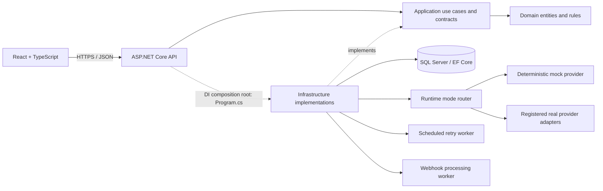

# IntegrationHub

## Enterprise API Integration & Monitoring Platform

IntegrationHub is a portfolio application for managing enterprise integrations. It brings client and provider catalogs, request execution, retries, webhook intake, incidents, operational logs, SLA reporting, and simulated provider migrations into one workspace. It has two backend-controlled runtime modes: `Simulation` for safe local demonstrations, and a prepared `Production` adapter pipeline. No real vendor adapter is included yet; in Production mode an unconfigured provider is blocked and never falls back to the simulator.

## Project goals

- Demonstrate a layered .NET 10 API and React TypeScript application.
- Model real operational concerns: idempotency, transient failures, retry history, dead letters, correlation, audit, role based access, and monitoring.
- Make the core workflows reproducible locally without external accounts or provider credentials.
- Keep secrets outside source control and keep tests isolated from developer databases.

## Key features

- Identity backed login, JWT access tokens, four roles, active user checks, rate limiting, and audited administrative mutations.
- Client, provider, and integration catalogs with validation, filters, and pagination.
- Simulation mode with deterministic mock outcomes, execution history, idempotency keys, exponential retries, scheduled retry processing, and manual retry.
- Production adapter contract and mode-aware routing. Production mode fails closed with a clear `503` result until a real adapter is implemented, registered, and configured.
- Signed webhook intake, duplicate event handling, background processing, incident workflows with comments, structured logs, and audit trail.
- SLA metrics computed from persisted execution records, provider performance summaries, incident dashboards, and migration history.
- Responsive React dashboard and operational list views. The backend exposes additional administrative and operational endpoints through Swagger.

## Architecture

The solution uses Clean Architecture. The API depends on Application. Application and Domain do not depend on Infrastructure. Infrastructure implements Application's persistence and provider contracts; `Program.cs` is the composition root that registers these implementations for dependency injection. See [docs/architecture.md](docs/architecture.md).



## Technology stack

| Area | Technology | Purpose |
|---|---|---|
| API | C#, .NET 10, ASP.NET Core | REST API, dependency injection, hosted workers |
| Business/data | Clean Architecture, EF Core 10, SQL Server 2019+ | Domain rules, use cases, SQL persistence and migrations |
| Security | ASP.NET Core Identity, JWT, role policies, FluentValidation | Password hashing, authentication, authorization and request validation |
| Operations | Serilog, Swagger/OpenAPI | Structured logs and API discovery |
| Web | React, TypeScript, Vite, Tailwind CSS, React Router | Responsive single page client |
| Web data/UI | Axios, TanStack Query, React Hook Form, Zod, Recharts, Lucide React | API access, server state, forms, charts and icons |
| Tests | xUnit, ASP.NET Core integration test host, SQLite in-memory | Domain/API checks using isolated data |
| Automation | GitHub Actions | Restore, build, tests and web build; Azure workflow template |

## Database design

SQL Server stores identity and operational records. Core relationships and constraints are described in [docs/database-design.md](docs/database-design.md). EF Core migrations are in `src/IntegrationHub.Infrastructure/Persistence/Migrations`.

## Business workflows

1. **Execution:** an authenticated user submits a JSON object. The API validates the integration and idempotency key, stores a correlated execution, and routes it according to `IntegrationRuntime:Mode`. `Simulation` calls the deterministic mock. `Production` calls only a registered adapter matching the provider type.
2. **Provider failure:** transient errors are recorded as attempts with response/error metadata. Eligible failures are scheduled with exponential backoff; permanent validation/authentication errors do not auto-retry.
3. **Retry/dead letter:** a hosted worker claims due records atomically, appends attempt history, and persists the next retry or dead-letter state. Authorized users may request a manual retry without replacing the original execution record.
4. **Webhook:** the receiver verifies the configured HMAC signature and event ID, validates a JSON object, stores the event, and returns 202. A worker processes it asynchronously.
5. **Incident:** qualifying recurring failures create or update an operational incident; users can assign, comment, change severity, and resolve it.
6. **SLA:** reports use persisted, completed executions in the selected UTC measurement window, including success rate, average/P95 latency, and configured targets.
7. **Migration:** a migration is a simulated business workflow. Status transitions are recorded in a history table; no external system is migrated.

## Prerequisites

- .NET SDK 10.0.300 or a compatible .NET 10 SDK (`global.json` pins 10.0.300).
- Node.js LTS and npm.
- SQL Server 2019 or newer (local, containerized, or managed) and a SQL client such as SSMS or Azure Data Studio. EF Core's SQL Server provider currently lists SQL Server 2019 onwards as supported. Use an edition licensed for your intended environment. [Microsoft compatibility reference](https://learn.microsoft.com/ef/core/providers/sql-server/).
- Git.

Docker is optional. The application uses a dedicated `IntegrationHub` database on the SQL Server endpoint you configure. For a local default instance, Windows Integrated Authentication can be used without storing a SQL password. The repository does not create, delete, or modify Docker resources.

## Local installation

From PowerShell:

```powershell
git clone https://github.com/<your-account>/IntegrationHub.git
Set-Location .\IntegrationHub
dotnet tool restore
dotnet restore .\IntegrationHub.sln
```

Set up the API's user-secrets store (values stay in your local .NET secrets store, not in Git):

```powershell
dotnet user-secrets init --project .\src\IntegrationHub.Api
dotnet user-secrets set "ConnectionStrings:IntegrationHub" "Server=localhost;Database=IntegrationHub;Integrated Security=True;Encrypt=True;TrustServerCertificate=True" --project .\src\IntegrationHub.Api
$jwt = [Convert]::ToBase64String([Security.Cryptography.RandomNumberGenerator]::GetBytes(32))
dotnet user-secrets set "Jwt:SigningKey" $jwt --project .\src\IntegrationHub.Api
dotnet user-secrets set "Seed:DemoPassword" "<choose-a-local-password-meeting-identity-policy>" --project .\src\IntegrationHub.Api
dotnet user-secrets set "Webhooks:SigningSecret" "<choose-a-local-webhook-secret>" --project .\src\IntegrationHub.Api
```

The sample `Server=localhost` targets a local default SQL Server instance. For a named local instance, use a generic endpoint such as `localhost\SQLEXPRESS`; for a managed server, use its approved DNS endpoint. Change only the `Server` value for your environment and keep the connection string in User Secrets or a managed secret store.

Replace placeholders locally; never paste real credentials into this README, frontend variables, or Git. `Seed:DemoPassword` must be at least 12 characters and include upper/lowercase, a digit, and a non-alphanumeric character. The database login needs permission to create/alter the `IntegrationHub` database schema.

Apply migrations and start the API:

```powershell
$env:ConnectionStrings__IntegrationHub = "Server=localhost;Database=IntegrationHub;Integrated Security=True;Encrypt=True;TrustServerCertificate=True"
dotnet ef database update --project .\src\IntegrationHub.Infrastructure --startup-project .\src\IntegrationHub.Api
dotnet run --project .\src\IntegrationHub.Api --launch-profile http
```

In a second terminal, start the web app:

```powershell
Set-Location .\src\IntegrationHub.Web
npm ci
npm run dev
```

Open `http://localhost:5173`. The API listens at `http://localhost:5121`; Swagger is at `http://localhost:5121/swagger` in Development. The Development startup configuration can apply migrations and seed fictional data when enabled. Demo accounts are created only when `Seed:DemoPassword` is configured; use `admin@integrationhub.local` and the password you chose above. Do not use this local seed account in production.

If you choose a separate SQL Server Docker instance instead, use a distinct database and a locally chosen secret. Example only (image pull consumes network and disk; SQL Server uses substantial memory/CPU):

```powershell
docker run --name integrationhub-sql --publish 1434:1433 --env ACCEPT_EULA=Y --env MSSQL_SA_PASSWORD="<strong-local-password>" --volume integrationhub-sql-data:/var/opt/mssql --detach mcr.microsoft.com/mssql/server:2022-latest
```

This is an optional new resource; review disk and memory capacity before pulling/running it. It is separate from any existing SQL Server container. Connection string for that port: `Server=localhost,1434;Database=IntegrationHub;User Id=sa;Password=<your-local-password>;Encrypt=True;TrustServerCertificate=True`.

## Configuration

| Key | Purpose |
|---|---|
| `ConnectionStrings:IntegrationHub` | SQL Server connection (User Secrets locally; managed secret store in deployment) |
| `Jwt:SigningKey` | Base64 encoded key with at least 256 random bits |
| `Jwt:Issuer`, `Jwt:Audience`, `Jwt:AccessTokenMinutes` | JWT validation and expiry |
| `Cors:AllowedOrigins` | Explicit browser origins |
| `Retry:WorkerEnabled`, `PollIntervalMs`, `BatchSize`, `MaxAttempts`, `InitialDelaySeconds`, `BackoffMultiplier` | Retry processing policy |
| `Webhooks:WorkerEnabled`, `PollIntervalMs`, `SigningSecret` | Webhook worker and HMAC key |
| `Sla:WindowDays`, `AvailabilityTargetPercent`, `MaximumAverageDurationMs` | SLA calculation window/targets |
| `RateLimiting:AuthPermitLimit`, `WebhookPermitLimit` | Request limits |
| `Seed:DemoPassword` | Optional local demo user seed; do not set in production |
| `IntegrationRuntime:Mode` | `Simulation` (default) or `Production`; API-side routing control |
| `IntegrationRuntime:AllowedHosts` | Exact HTTPS hostnames allowed for provider endpoints in Production mode |

Non-secret examples are in `src/IntegrationHub.Api/appsettings.json`; `appsettings.Production.json` selects Production mode and disables startup migrations/seeding. `.env.example` contains only the frontend API URL. API secrets are not read from the web app.

### Runtime modes and real providers

- Keep `IntegrationRuntime:Mode=Simulation` for local development, testing and demonstrations. Existing mock provider behavior remains the default.
- `ASPNETCORE_ENVIRONMENT=Production` loads `appsettings.Production.json` and selects Production mode. Switching modes is a server deployment/configuration action, not a browser toggle.
- Production mode never sends requests through a mock adapter. A provider must have an HTTPS `BaseUrl` whose hostname is in `IntegrationRuntime:AllowedHosts`; otherwise execution is blocked before network access. A missing adapter is returned as a permanent `PRODUCTION_ADAPTER_NOT_CONFIGURED` failure.
- Implement `IProductionIntegrationProvider` in Infrastructure for each real provider type, register it in `DependencyInjection.AddInfrastructure`, and provide its credentials via a managed secret store. The current repository intentionally contains no vendor endpoint, credential, or real adapter.
- The authenticated `GET /api/system/runtime` endpoint and Runtime settings page report the active mode and registered adapter types without exposing secrets.
- Before using real systems, add provider contracts/tests, webhook signature policies, endpoint allowlists, per-vendor rate limits, secret rotation, operational alerts and a staged production validation plan. See [docs/deployment.md](docs/deployment.md).

## Demo credentials

There are no committed demo passwords. On first Development startup, if `Seed:DemoPassword` exists in User Secrets, the seeder creates `admin@integrationhub.local`, `integrations@integrationhub.local`, `support@integrationhub.local`, and `readonly@integrationhub.local` with their respective roles and the local password you configured. These are fictional local development accounts.

## API documentation

Swagger UI: `http://localhost:5121/swagger` while the API is running in Development. Endpoint groups include auth, clients, providers, integrations, executions, execution logs, incidents, webhook reception/events, migrations, dashboard, reports, users, and logs. See [docs/api-documentation.md](docs/api-documentation.md) for routes and examples.

## Testing

```powershell
dotnet test .\IntegrationHub.sln
Set-Location .\src\IntegrationHub.Web
npm ci
npm run build
```

Verified locally: 15 unit tests and 8 API integration tests pass in Release. Integration tests use isolated in-memory SQLite databases; they do not connect to SQL Server or Docker. Frontend lint and production build pass, and `npm audit --omit=dev` reports no production dependency vulnerabilities. There is no frontend test script or browser end-to-end suite yet. See [docs/testing-strategy.md](docs/testing-strategy.md).

## CI/CD

`.github/workflows/ci.yml` restores/builds .NET, runs the test suite, and installs/builds the web app. `deploy-api.yml` is a manually dispatched Azure App Service template; add repository secrets and review the workflow before enabling deployment. No deployment has been performed. See [docs/deployment.md](docs/deployment.md).

## Screenshots

No repository screenshots are included yet. Add reviewed screenshots under `docs/screenshots/` and update this section when available.

## Project structure

```text
IntegrationHub.sln
src/
  IntegrationHub.Domain/          Entities, enums, domain rules
  IntegrationHub.Application/     Contracts, validation, use cases
  IntegrationHub.Infrastructure/  EF Core, Identity, mock adapter, workers
  IntegrationHub.Api/             HTTP, security, composition root
  IntegrationHub.Web/             React + TypeScript client
tests/
  IntegrationHub.UnitTests/
  IntegrationHub.IntegrationTests/
docs/
```

## Security and limitations

Passwords are hashed by ASP.NET Core Identity. Access tokens are signed with a secret key. Role policies, input validation, request size limits, rate limits, HMAC webhook validation, audit events, and centralized ProblemDetails errors are implemented. Secrets belong in .NET User Secrets locally and a managed secret store in hosted environments. Never commit `appsettings.*.Local.json`, `.env`, or secret material.

IntegrationHub is a portfolio/demo application, not a production financial processing platform. Provider adapters are fictional simulations; there are no real payment rails, external provider credentials, production failover guarantees, or regulatory certifications. Production deployment requires security review, managed SQL, secret/key rotation, monitoring, backup/restore plans, TLS, and operational ownership.

## Roadmap

- Complete edit/status workflows and role-aware action handling consistently across every frontend module.
- Expand automated coverage for concurrent retries, incident lifecycle, migration transitions, SLA boundary conditions, and broader authorization cases; add browser-level acceptance tests.
- Add distributed tracing and an outbox/message broker for multi-instance processing.
- Complete production deployment hardening, monitoring dashboards, and accessibility review before hosting outside a local demo environment.

## License

MIT. See [LICENSE](LICENSE).

## Author

Project author: `<Your Name>` (replace with your preferred public name).
