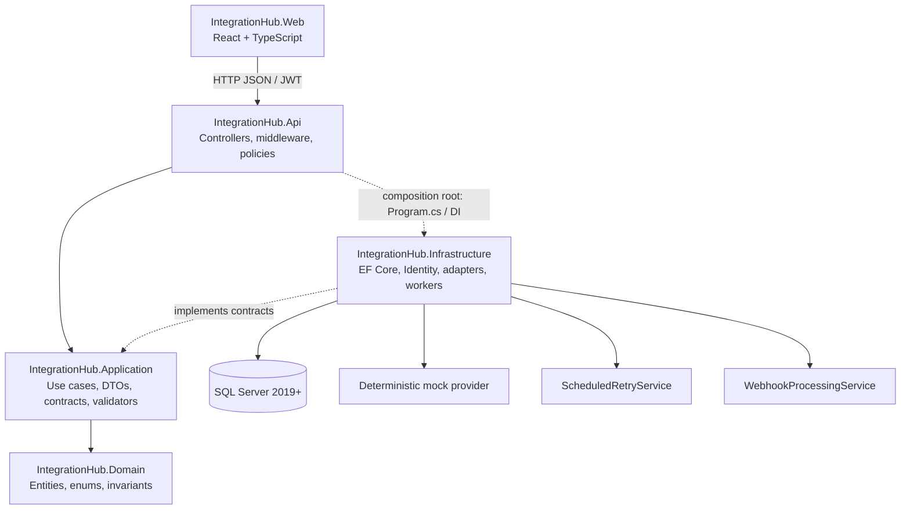

# Architecture

## Dependency direction

IntegrationHub follows Clean Architecture. The Domain project contains entities and invariant rules. Application orchestrates use cases and owns interfaces for data access, provider execution, authentication, clocks, and operational records. Infrastructure implements those Application contracts with EF Core, Identity, mock adapters, and background services. The API handles HTTP and authorization. Its `Program.cs` registers Infrastructure implementations at the composition root; controllers call Application services/contracts and do not access EF Core directly.

The dashed API-to-Infrastructure connection represents startup dependency injection configuration only. Domain has no dependency on API, Application, or Infrastructure. Infrastructure references Domain and Application to implement persistence and external service contracts.

## Runtime request flow

1. The React app sends JSON requests through a centralized Axios client. A JWT is read from session storage and attached to authenticated API calls.
2. ASP.NET Core applies correlation, rate limit, CORS, authentication, authorization, validation, and exception handling.
3. A controller invokes an Application use case or contract. The use case applies orchestration and domain rules.
4. Infrastructure persists state or invokes the deterministic mock adapter. Retry and webhook workers create scopes and process durable due records asynchronously.
5. The API returns DTOs and `ProblemDetails`; it does not expose EF entities.

## Projects

| Project | Responsibility |
|---|---|
| `IntegrationHub.Domain` | Business entities, enums, and state transitions |
| `IntegrationHub.Application` | DTOs, contracts, validators, use cases, policies |
| `IntegrationHub.Infrastructure` | EF Core mappings/stores, Identity, provider simulation, workers, seeding |
| `IntegrationHub.Api` | REST controllers, JWT and role policy setup, Swagger, middleware, DI composition root |
| `IntegrationHub.Web` | React SPA, routes, authentication state, dashboard and operational views |
| `IntegrationHub.UnitTests` | Domain and deterministic adapter tests |
| `IntegrationHub.IntegrationTests` | API workflow tests over isolated in-memory SQLite |

## Background work

`ScheduledRetryService` polls retry-eligible executions and claims them atomically before processing. `WebhookProcessingService` polls queued events and records processing outcome. Both are hosted services configured by `Retry:*` and `Webhooks:*`; for multi-instance production deployments, add a distributed queue/lease design and operational monitoring.

### Provider runtime modes

`IIntegrationProvider` is the application-facing port. Infrastructure registers `ModeAwareIntegrationProvider`, which dispatches to the deterministic simulator in `Simulation` mode or to a registered `IProductionIntegrationProvider` matching the provider type in `Production` mode. Production routing is fail-closed: it returns `PRODUCTION_ADAPTER_NOT_CONFIGURED` rather than calling the simulator when no real adapter exists. Adapter secrets belong in the deployment secret manager and adapter classes are registered in the Infrastructure composition extension.

## Security boundaries

ASP.NET Core Identity hashes passwords. JWT signing material is read from configuration at startup and must be a base64 key with at least 256 bits. Policies separate view, integration management, retry, and user-management access. Webhooks require HMAC signatures even though their receive endpoint is anonymous to support provider callbacks. Never log payload secrets or signing material.
