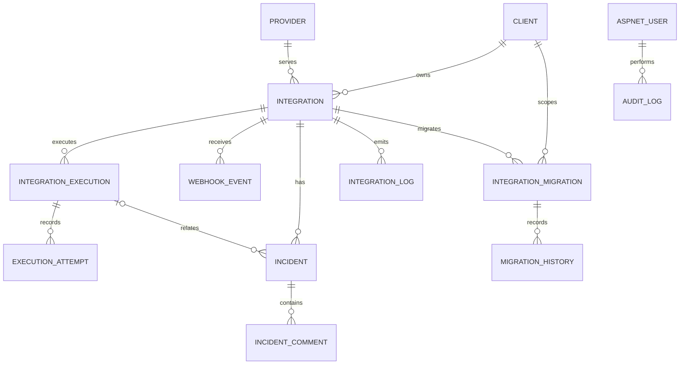

# Database design

SQL Server 2019 or newer is the supported local/managed database target for the EF Core SQL Server provider; EF Core migrations define the schema. Configure a SQL Server endpoint and authentication method appropriate for your environment through .NET User Secrets locally or a managed secret store when deployed. Integration tests use isolated in-memory SQLite with the same model and do not access any developer SQL Server or Docker database. Application timestamps are UTC `DateTimeOffset` values. Identity tables are created by ASP.NET Core Identity. See Microsoft's [EF Core SQL Server provider compatibility](https://learn.microsoft.com/ef/core/providers/sql-server/).

## Main tables

| Table/entity | Important fields and constraints |
|---|---|
| `AspNetUsers`, Identity roles/claims | ASP.NET Core Identity user, hashed password, active flag and role membership |
| `Clients` | Unique code; name, legal name, email, phone, active state, timestamps |
| `Providers` | Unique code; type, status, timeout, deterministic mock failure mode |
| `Integrations` | Unique code; client/provider foreign keys, type, environment and status |
| `IntegrationExecutions` | Integration, correlation, idempotency key, JSON request/response, status, retry time and outcome; filtered unique integration/idempotency index |
| `ExecutionAttempts` | Append-only attempt number, timestamps, duration and provider outcome; unique execution/attempt number |
| `WebhookEvents` | Integration, external event ID, correlation, payload and processing state; filtered unique integration/event ID index |
| `Incidents`, `IncidentComments` | Number, integration/execution relation, severity/status, assignment and comment history |
| `IntegrationLogs`, `AuditLogs` | Queryable operational and administrative event records with correlation and timestamps |
| `IntegrationMigrations`, `MigrationHistory` | Simulated migration business state and status history |

Foreign keys restrict deleting operational parents to preserve traceability; incidents may clear an execution reference if that record is removed. Indexes support unique business codes, idempotency/event deduplication, execution lookup by integration/correlation/status/time, incident status/severity, log filters, and migration history. Operational records are intended to be retained; no API exposes delete operations for audit/log history.

## Migrations and seed data

Current EF migrations: `InitialSchema` and `SyncNavigationModel` (the latter updates EF's model snapshot and has no SQL changes). Use `dotnet ef database update --project src/IntegrationHub.Infrastructure --startup-project src/IntegrationHub.Api` to apply them. Development startup migration is opt-in via `Database:ApplyMigrationsOnStartup`.

Fictional demo data contains 5 clients, 5 providers, 10 integrations, 30 executions, 5 incidents, and 3 simulated migrations. User records are seeded only when `Seed:DemoPassword` is set in local User Secrets. Seeding runs only when the catalog is empty. IDs are generated as records are created; the data shape and scenarios are repeatable, while generated identifiers and timestamps vary.
